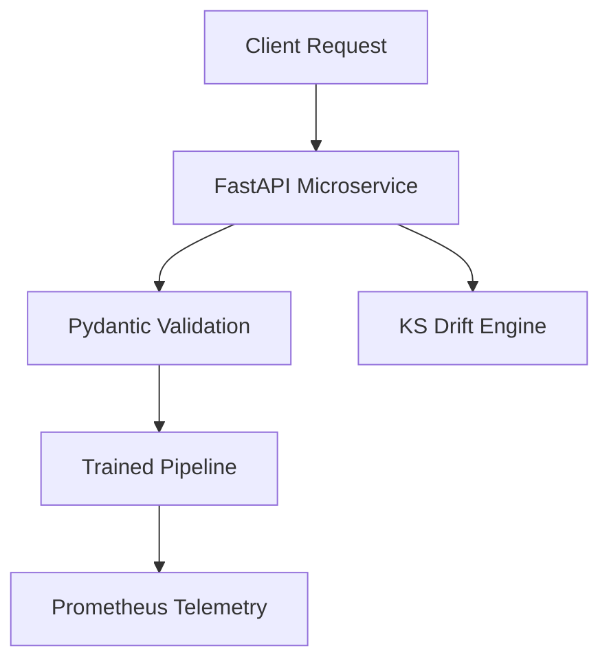

# MLOps Model Serving: Production FastAPI & Drift Monitoring


Production-grade MLOps deployment architecture featuring real-time REST inference, telemetry monitoring, and automated distribution drift detection.

## Architecture


## Quick Start
```bash
docker-compose up --build
```
